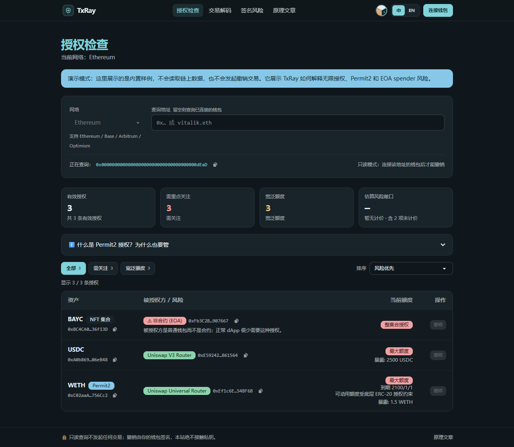
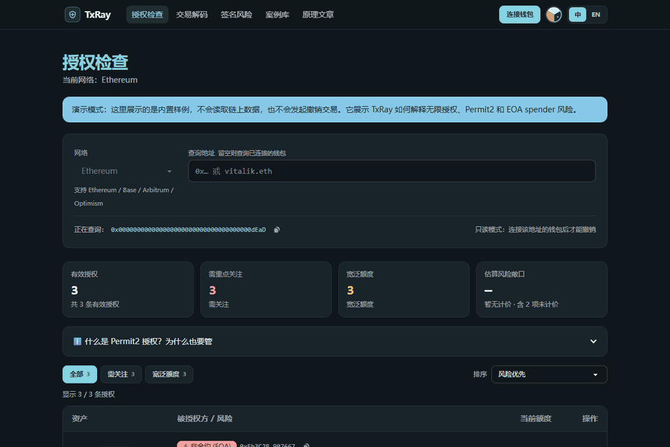

# TxRay — Web3 授权与交易风险检查器

**语言:** 中文 | [English](./README.en.md)

[](https://sophran-tools.vercel.app/tools/txray)
[](https://sophran-tools.vercel.app/tools/txray/approvals?demo=1)
[](https://github.com/Sophran-fbj/txray/actions/workflows/ci.yml)
[](./LICENSE)

> 检查 ERC-20、NFT 和 Permit2 授权，解码交易与 EIP-712 签名，并用人话解释风险。

> [!IMPORTANT]
> **安全边界：** 默认只读。演示模式只使用内置样例，不连接钱包、不读取地址，也不发送交易。撤销授权必须由用户在钱包中明确确认；本站绝不接触助记词或私钥。



<p align="center"><strong>20 秒操作演示：无需连接钱包即可体验授权检查与交易解码</strong></p>
<p align="center"></p>

TxRay 提供 **授权检查**、**交易解码** 和 **Signature Risk**，分别用于分析代币授权、交易输入数据和 EIP-712 签名风险。

这些工具关注真实的用户安全场景：钱包连接、索引化链上数据、RPC 读取、multicall、calldata 解码、Permit2 授权分析、EIP-712 typed data 检查，以及面向用户的人话解释。

## 为什么做这个项目

很多钱包和浏览器工具会给出原始警告，但用户经常仍然看不懂自己到底授权了什么、签了什么。

TxRay 的核心是 **检测 + 解释**：

- 检测高风险代币授权和 Permit2 授权。
- 解码 calldata 和常见危险函数选择器。
- 用人话解释风险，并把风险点链接到对应的原理文章。

## 当前功能

### TxRay · 授权检查

- 通过服务端 Etherscan 索引器读取 ERC-20、ERC-721 和 Permit2 授权历史。每次扫描固定截止区块，可查看各类事件的区间覆盖，继续扫描达到分页预算的区间，或单独重试请求失败的区间。
- 用分块的 viem multicall 校验当前授权额度，过滤已经失效的历史授权。同一代币的元数据和余额在一次扫描中只读取一次。
- 区分 ERC-20 和 Permit2 的类型最大额度与大额有限授权。
- 检测 NFT `setApprovalForAll` 整集合授权和 ERC-721 单件 `Approval`；单件授权以当前 `ownerOf` / `getApproved` 校验，历史事件不直接当作现状。
- 检查 Uniswap Permit2 内部授权，而不只看表层的 ERC-20 approve。
- 支持 Ethereum、Base、Arbitrum、Optimism。
- 估算 `$ at risk`：普通 ERC-20 用 `min(当前余额, 授权额度)`；Permit2 还受 ERC-20 对 Permit2 的底层授权约束，读取失败时标为未知，不会当作零。通过服务端批量查询并缓存 CoinGecko 美元价格；页面明确展示完整、部分或不可用的价格覆盖状态。
- 识别 spender 风险：
  - Ethereum / Base / Arbitrum / Optimism 链级隔离的已知可信合约标签；
  - 检测当前账户的 EIP-7702 委派状态（`0xef0100` delegation indicator），并对委派目标合约执行风险检查；
  - EOA spender；
  - 新部署的未知合约；
  - 未知合约；
  - Scam Sniffer 公开恶意地址情报（每日更新、公开数据约延迟 7 天）；不可用时明确降级，未知绝不等同于安全。
- 通过已连接钱包撤销 ERC-20、NFT 和 Permit2 授权。写入前匹配目标链并模拟合约调用，交易确认后在回执区块核验对应权限是否已经清除。
- 支持分享 URL 深链接（`?chain=&address=`）与演示模式（`/tools/txray/approvals?demo=1`）。

### TxRay · 交易解码

- 直接解码 calldata；支持通过显式“复制链接”生成 `?chain=&calldata=&target=`（或已打包交易 `?chain=&tx=`）分享链接，直接粘贴 calldata 时不会自动写入浏览器地址栏。
- 优先使用本地内置与容器/Permit2 ABI 进行离线解码；查询未上链交易或手动给定目标地址时结合 Etherscan 已验证 ABI（含一跳代理实现地址解析与循环保护）增强根调用与接口识别，已确认的历史交易不会直接套用当前代理实现以避免升级后误判。
- 在选定的 Ethereum、Base、Arbitrum 或 Optimism 网络通过交易哈希读取交易输入和回执。页面展示外层交易状态以及回执中可识别的 ERC-20、ERC-721 转账与授权和 NFT 集合授权事件，空 calldata 的交易也可查看回执。
- 识别 `approve`、`setApprovalForAll`、`permit`、`transferFrom`、`transfer` 等常见选择器。
- 递归展开 Multicall3、`multicall(bytes[])`、Safe `execTransaction` / `multiSend`、Uniswap Universal Router `execute(commands, inputs)`、智能账户 `execute/executeBatch` 和 ERC-4337 `handleOps`，并把风险定位到具体调用路径。
- 对递归深度、节点数和原始数据预览设置硬上限；未知、截断和解析不完整的路径默认展开，不会被描述为安全。
- 高亮高风险调用，并解释函数可能授权什么。
- 未知选择器 fallback 到 OpenChain 签名库查询。

### Signature Risk · EIP-712 签名风险解释器

- 粘贴钱包签名弹窗中的 typed-data JSON，或从案例库一键载入样本分析。
- 识别 ERC-20 `permit`、Permit2 typed data（区分持续额度授权与一次性转账签名）和 Seaport / NFT 订单类签名。
- 面向 Seaport 等订单签名展示 **Offer（你交出） vs Consideration（你收到）** 对照面板，并标出“零回报”高危订单与流向第三方的条款。
- 抽取安全关键字段：
  - spender / operator / conduit；
  - token；
  - amount；
  - deadline / expiration / endTime；
  - verifying contract；
  - nonce。
- 标记无限额度和长期有效签名。
- 完全只读：不会要求钱包签署任何内容。

### 案例库（Case Lab）与原理文章

- 交互式案例库 `/cases`：按授权陷阱、批量与路由、签名钓鱼分类展示真实风险案例，一键带着离线确定性载荷跳转至 Decoder 或 Signature Risk 拆解分析。
- `/articles/why-unlimited-approval-is-dangerous`
- `/articles/permit2-eip712-phishing`
- `/articles/why-batched-transactions-hide-risk`
- `/articles/eip-7702-delegated-eoa-risk`

站点通过轻量本地 i18n provider 支持中文和英文切换。

## 技术栈

| 层 | 选择 |
|---|---|
| 框架 | Next.js 16 App Router + React 19 |
| 语言 | TypeScript |
| 钱包 | RainbowKit 2 |
| 链交互 | wagmi 2 + viem 2 |
| 查询/缓存 | TanStack Query |
| UI | Tailwind CSS 4 + DaisyUI 5 |
| 测试 | Vitest + Playwright |
| 包管理 | pnpm |

## 架构

单个 Next.js 应用。工具以路由形式存在，业务逻辑放在 `src/features` 下。

```text
src/
├─ app/
│  ├─ tools/txray/          # TxRay 路由
│  ├─ articles/             # 原理文章
│  └─ api/                  # 服务端索引器/签名辅助路由
├─ components/              # 共享 UI 组件
├─ content/articles.ts      # 轻量文章内容注册表
├─ features/txray/          # 授权与交易解码逻辑
├─ features/signature-risk/ # EIP-712 签名分析逻辑
└─ lib/
   ├─ i18n/                 # 本地双语文本 provider
   └─ web3/                 # wagmi / viem 配置
```

当前刻意不使用 monorepo。项目只有一个可部署应用，常规项目内 import 已足够。等出现需要独立部署的第二个应用时，再升级成 workspace。

## 数据流

| 数据 | 运行位置 | 原因 |
|---|---|---|
| 授权历史 | 服务端路由 -> Etherscan 索引器 | 免费 RPC 全历史 `eth_getLogs` 不现实。 |
| 当前额度 / 元数据 | 浏览器 -> viem multicall | 读取实时链上状态，不需要自有服务端状态。 |
| spender 创建信息 | 服务端路由 -> Etherscan | API key 留在服务端。 |
| calldata 解码 | 浏览器 + 签名查询路由 | 按目标 ABI 解码。回退到选择器时先查本地表，未知再查 OpenChain。 |
| 目标合约 ABI | 服务端路由 → Etherscan | 仅传送所选链和目标合约地址。查询或匹配失败时回退到本地选择器表和 OpenChain。 |
| EIP-712 分析 | 浏览器本地 | 纯 JSON 检查，不需要 RPC，也不需要签名。 |
| Token 价格 | 浏览器 -> 服务端批量缓存 -> CoinGecko | 仅用于 `$ at risk` 估算；失败或缺价时明确显示覆盖范围，并回退到 token 数量。 |

## 安全姿态

- 永不索要助记词或私钥。
- 默认都是只读分析。
- 写操作只限于用户通过钱包主动发起的撤销交易。
- Etherscan API key 保留在服务端。
- 不持久化钱包地址或建立用户画像；授权和合约信息路由会瞬时处理查询地址，并将查询条件发送给 Etherscan。RPC 请求受节点服务商隐私政策约束；价格路由只把 token 合约地址发送给 CoinGecko，不发送钱包地址。
- 恶意地址检查由服务端定期获取 Scam Sniffer 完整公开列表后在本地匹配，不会把用户查询地址发送给情报源。
- WalletConnect 和 Alchemy public key 属于前端 key，应在供应商后台配置域名限制。

## 本地开发

```bash
pnpm install
cp .env.example .env.local
pnpm dev
```

需要的环境变量：

| 变量 | 用途 |
|---|---|
| `NEXT_PUBLIC_WC_PROJECT_ID` | Reown / WalletConnect Project ID，用于 RainbowKit |
| `NEXT_PUBLIC_ALCHEMY_ID` | Alchemy RPC key |
| `ETHERSCAN_API_KEY` | Etherscan V2 API key，服务端路由使用 |
| `COINGECKO_DEMO_API_KEY` | 可选但建议配置；CoinGecko Demo API key，只在服务端使用；未配置时无 Key 模式每次只补充 1 个未缓存 token，并明确显示部分覆盖 |
| `DEV_PROXY` | 可选，本地开发时让服务端 fetch 走 HTTP/混合代理 |
| `UPSTASH_REDIS_REST_URL` | 可选；生产环境跨实例共享限流、Etherscan 节流和短期授权缓存 |
| `UPSTASH_REDIS_REST_TOKEN` | 可选；对应 Redis REST 写入 token，只能放在服务端 |

`DEV_PROXY` 示例：

```env
DEV_PROXY=http://127.0.0.1:10808
```

本地未配置 `NEXT_PUBLIC_WC_PROJECT_ID` 时仍可构建，并只启用浏览器注入钱包；生产环境应配置真实且限制域名的 Project ID。

未配置 Redis 时服务会自动回退到进程内限流、请求队列和缓存，适合本地开发；Serverless 生产环境建议配置共享后端。API 响应通过 `X-TxRay-Guard` 和 `X-TxRay-Cache` 暴露当前使用的保护与缓存层，包括共享缓存未命中和降级状态。共享缓存 TTL 为 60 秒，钱包地址和客户端 IP 只用于生成服务端 HMAC 键，不以明文写入 Redis。

## 已知限制

- Etherscan 日志每次查询对单个事件区间最多读取 10,000 条。触顶时可分段继续扫描，单个区块触顶时会保留不完整标记。若有待扫或失败区间，页面会显示扫描不完整。
- spender 可信标签按链隔离，目前仅收录部分已经在 Ethereum、Base、Arbitrum、Optimism 核验的 canonical 核心合约地址（如 Permit2、Uniswap Router、Safe 等）；未收录地址仍按新部署合约、普通未知合约或 EOA 处理。
- ABI 查询支持通过 Etherscan 对常见代理合约执行一跳实现地址解析并防循环；若代理与实现合约均未验证，将回退至内置选择器/容器 ABI 或 OpenChain 查询。
- 单次授权扫描最多查询 500 个唯一 token 的美元价格，每个服务端批次最多 100 个；超过预算、CoinGecko 无报价或无 Key 模式受上游限制时，页面会显示部分覆盖，未报价不会被当作零风险。
- Signature Risk 会按 EIP-712 `types` 校验字段值并展开结构和数组；缺少 schema 时仅做保守字段扫描，并在页面明确提示。结构校验及模式识别不等于验证接收合约的实际语义。输入中的截止时间已过不等于本站验证了接收合约会拒绝该签名，因此不会自动降低整体风险等级。

## 验证

```bash
pnpm lint
pnpm typecheck
pnpm test
pnpm build
pnpm e2e
```

首次运行 E2E 前执行 `pnpm exec playwright install chromium`。GitHub Actions 会在 push 和 pull request 上执行同一组检查。

## 后续方向

- 补充更多真实 spender 标签和公开 drainer/blocklist 数据源。
- 在 Ethereum / Base / Arbitrum / Optimism 稳定后继续扩展更多链。
- 在 CoinGecko 之外增加第二价格源，并对低流动性报价增加质量提示。
- 内容增长后，将文章系统升级为 MDX。

## License

[MIT](./LICENSE)
